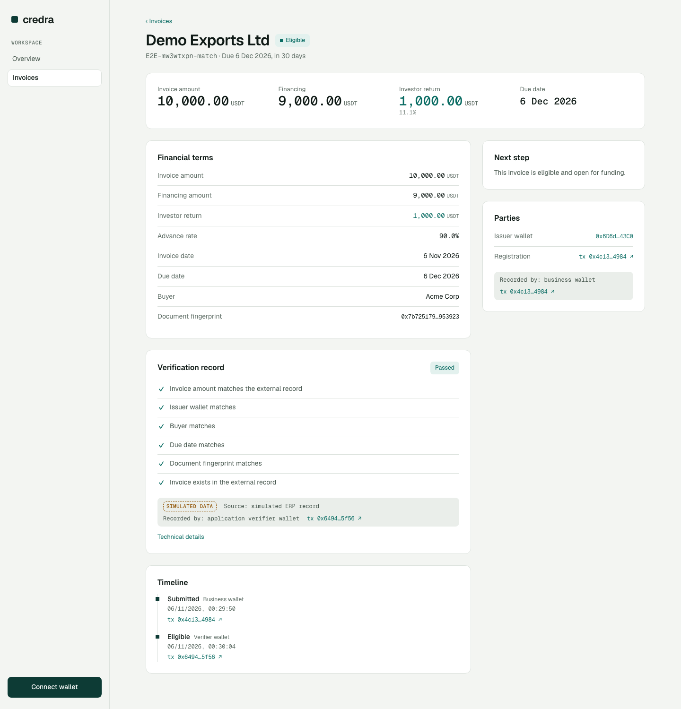
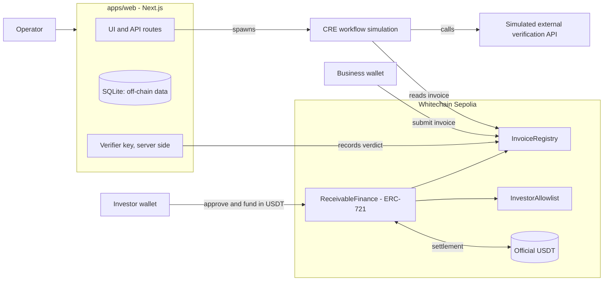

<div align="center">


<br />

**Turn verified invoices into working capital.**

Register an invoice on Whitechain, verify it with a Chainlink CRE workflow, fund it in USDT, settle on repayment.

[](LICENSE)
[-0D3B35)](https://explorer.testnet.whitechain.io)
[](https://docs.chain.link/cre)
[](#testing)
[](#current-limitations)

[Quick start](#quick-start) · [How it works](#how-it-works) · [Architecture](#architecture) · [Deployed contracts](#deployed-contracts) · [Limitations](#current-limitations)

</div>

---

Credra lets a business finance an invoice it is still waiting to be paid on. The invoice is registered onchain, checked against an external record by a **Chainlink CRE workflow**, and, once eligible, funded by an allowlisted investor in the official **USDT**. The investor receives a receivable token that only allowlisted wallets can hold, and repayment goes to whoever holds it.

Built at **ETHGlobal Mumbai 2026** for the Whitechain *Tokenize: Real World Finance* and Chainlink *Best workflow with CRE* tracks. **This is testnet software.** Tokens have no value, the external verification source is simulated, and it is not a live lending product.

<p align="center">
  
  <br />
  <sub>An eligible invoice on Whitechain Sepolia: terms, verification record, who recorded it, and explorer links for each step.</sub>
</p>

## Contents

- [Status](#status)
- [Quick start](#quick-start)
- [How it works](#how-it-works)
- [Architecture](#architecture)
- [Why onchain stablecoin settlement on Whitechain](#why-onchain-stablecoin-settlement-on-whitechain)
- [How CRE is used](#how-cre-is-used)
- [Deployed contracts](#deployed-contracts)
- [Repository structure](#repository-structure)
- [Setup](#setup) · [Testing](#testing)
- [Current limitations](#current-limitations)
- [Roadmap](#roadmap) · [AI usage](#ai-usage) · [License](#license)

## Status

An honest snapshot of what works today.

| Area | Status |
|---|---|
| Contracts on Whitechain Sepolia (1874), source-verified | Done |
| CRE workflow: reads Whitechain state, calls an external API, runs through the CRE CLI | Done |
| Web app: submit invoice, verification, invoice pipeline, detail page, operator tools | Done |
| Verdict recorded onchain; failures and outages fall back to manual review, never "eligible" | Done, tested on testnet |
| Investor funding and repayment UI (approve USDT, then fund or repay; positions; default) | Built and typechecked. **The explorer-linked USDT payment is pending** until the wallets receive official test USDT |
| Operator: approve or reject manual-review invoices, manage the investor allowlist | Done, tested on testnet |
| Demo video, landing page | Pending |

Evidence lives in [`evidence/`](evidence/): CRE runs, the supported-chains output, deployment and end-to-end transaction links.

## Quick start

```bash
git clone --recurse-submodules https://github.com/abbylester1/credra && cd credra
cp .env.example .env            # throwaway TESTNET keys only. Never commit .env

cd contracts && forge test      # 29 tests, no wallet needed
```

To run the whole stack you also need Node 22, [bun](https://bun.sh) and the [CRE CLI](https://docs.chain.link/cre/getting-started/cli-installation) with a completed `cre login`. See [Setup](#setup).

## How it works

1. **Submit.** A business wallet registers an invoice with `InvoiceRegistry.submitInvoice`: a document fingerprint (keccak256), a hashed buyer reference, amounts and a due date. The contract refuses a duplicate invoice id or document.
2. **Verify.** The app runs the CRE workflow. It reads the invoice from Whitechain, calls the external verification API, compares the two, applies the eligibility rules, and returns `ELIGIBLE`, `REJECTED` or `MANUAL_REVIEW`.
3. **Record.** The app's verifier wallet writes the verdict onchain. Any error, timeout or outage during verification becomes manual review and **never** eligible.
4. **Fund.** An allowlisted investor funds an eligible invoice in USDT. The business is paid directly, and the investor receives an ERC-721 receivable ("Credra Receivable", `CRDR`) that can only move between allowlisted wallets.
5. **Repay.** The full invoice amount is paid to the current holder. After the due date plus a 3-day grace period, anyone can mark the invoice defaulted.

**Economics:** the investor pays the financing amount (for example 9,000 USDT) and is repaid the invoice amount (10,000 USDT); the difference is the investor's discount. The contracts never hold funds and have no administrator withdrawal.

## Architecture



## Why onchain stablecoin settlement on Whitechain

Invoice financing needs several parties to trust one record: the issuer, the investor, and whoever verifies. A bank rail can move the money, but it cannot also enforce who may hold the receivable, refuse a second financing of the same invoice, or let anyone inspect the verification record and payment trail without asking the platform.

Here the registry rejects duplicate invoices and documents, the allowlist and status machine are enforced by the contracts, and USDT moves straight from investor to business and back to the holder with no platform custody. A regular payment rail could not make "financing and repayment follow the receivable token" one atomic, auditable rule.

## How CRE is used

The workflow in [`cre/invoice-verification`](cre/invoice-verification) is the verification step of the product, not decoration. It is triggered with an invoice id, **reads the invoice from the Whitechain registry**, **calls an external verification API**, compares onchain and external data (issuer wallet, buyer, amount, due date, document fingerprint), applies the eligibility rules, and returns a verdict with failed checks and an external reference. The web app runs it with `cre workflow simulate` and uses the result to decide whether an invoice can reach financing.

**Trust model, stated plainly:**

- Whitechain is **not** in this CRE tenant's supported-chains list ([evidence](evidence/cre-supported-chains.txt)), so it is declared as an experimental chain and read through its RPC in simulation.
- The verdict is recorded by the **application's verifier wallet**, an application-authorised transaction. It is **not** a DON-signed or CRE-attested write.
- The external verification source is **simulated** (`apps/mock-registry`). A document fingerprint proves a document has not changed, not that an invoice is genuine.

## Deployed contracts

Whitechain Sepolia, chain id 1874, all source-verified.

| Contract | Address |
|---|---|
| InvoiceRegistry | [`0xc11162A72F388Efb6Ddd0B73Eea578598d733122`](https://explorer.testnet.whitechain.io/address/0xc11162A72F388Efb6Ddd0B73Eea578598d733122) |
| InvestorAllowlist | [`0xE27c2C0BF2A6C34749257f0FD519c9e531ff4B51`](https://explorer.testnet.whitechain.io/address/0xE27c2C0BF2A6C34749257f0FD519c9e531ff4B51) |
| ReceivableFinance | [`0x3025FDea4Aa3A96deC46451b7Eec2e83188307B6`](https://explorer.testnet.whitechain.io/address/0x3025FDea4Aa3A96deC46451b7Eec2e83188307B6) |
| Official USDT (not ours) | [`0xcedfB56113143d55b2358b8CFbB0dEB5Ad2f55a7`](https://explorer.testnet.whitechain.io/address/0xcedfB56113143d55b2358b8CFbB0dEB5Ad2f55a7) |

Transactions and end-to-end results: [`evidence/whitechain-transactions.md`](evidence/whitechain-transactions.md) and [`evidence/e2e-mvp-testnet.md`](evidence/e2e-mvp-testnet.md). USDT funding and repayment transaction links will be added here once recorded.

## Repository structure

```text
contracts/               Foundry project: InvoiceRegistry, InvestorAllowlist, ReceivableFinance (29 tests)
cre/invoice-verification/  CRE workflow (TypeScript) and pure eligibility rules (11 tests)
apps/web/                Next.js app: UI, API routes, verification runner (26 tests)
apps/mock-registry/      Simulated external verification API
specs/                   Spec Kit: specification, plan, tasks, UI spec
evidence/                CRE runs, transaction links, static analysis
docs/                    Images and design documentation
DESIGN.md                Design system reference
```

## Setup

**Prerequisites:** Node 22, [bun](https://bun.sh), [Foundry](https://getfoundry.sh), the [CRE CLI](https://docs.chain.link/cre/getting-started/cli-installation) (v1.39.0 used) and a completed `cre login`.

```bash
# 1. Run the stack
cd apps/mock-registry && bun server.ts            # simulated external API on :8787
cd apps/web && bun install && bun run dev         # app on :3000, open /app

# 2. Optional: end-to-end on testnet, acting as the business wallet
cd apps/web && bun --env-file ../../.env scripts/e2e-mvp.ts
```

**Wallets:** import the throwaway business and investor keys into a browser wallet on Whitechain Sepolia (chain id 1874, RPC `https://rpc.testnet.whitechain.io`). Gas comes from the [Whitechain faucet](https://faucet.testnet.whitechain.io/); test USDT comes from the sponsor.

### Testing

```bash
cd contracts && forge test                                   # 29 tests
cd cre/invoice-verification && bun install && bun test       # 11 tests
cd apps/web && bun run test                                  # 26 tests
```

Static analysis ([Slither](evidence/slither.md)) found 5 low-severity items and no medium or high ones. That is a first pass, not an audit.

## Current limitations

- Testnet only. Test tokens have no value. Not a live lending or investment product, and not legal, credit or compliance advice.
- The external verification source is simulated. Verification is not legal enforceability or creditworthiness.
- Verdicts are recorded by an application wallet, not by the CRE network. CRE runs through the CLI simulator; deployment access is not enabled on this account.
- One investor per invoice. No secondary market, KYC, credit scoring or automatic detection of the buyer's payment; repayment is an explicit transaction.
- Operator access is a demo passcode. Wallet authentication is signature based with a 10-minute window and no nonce store.
- Both public RPCs are intermittently slow, so the app reads through a fallback transport.
- No funding or repayment has been executed on testnet yet because the wallets hold no official test USDT. The demo video and landing page are not finished at the time of writing.

## Roadmap

- [x] Contracts, deployment and explorer verification
- [x] CRE verification workflow driving eligibility
- [x] Invoice submission and verification in the app
- [x] Investor funding and repayment screens, positions and default
- [x] Operator review of manual-review invoices and allowlist management
- [ ] Record the official-USDT funding and repayment transactions on testnet (needs test USDT)
- [ ] Transactions and verification pages
- [ ] Landing page and demo video

## AI usage

Built with substantial help from Claude (Anthropic) through Claude Code: contract drafting and tests, the CRE workflow, the web app, specifications and documentation. Everything was run and checked in this repository, and the evidence files record real testnet runs.

## License

[MIT](LICENSE)
